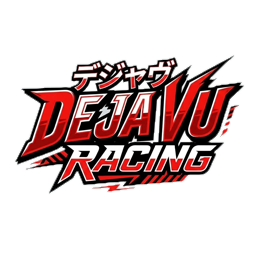
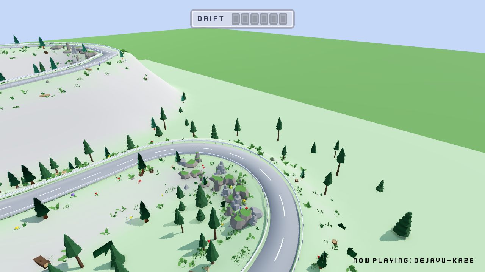
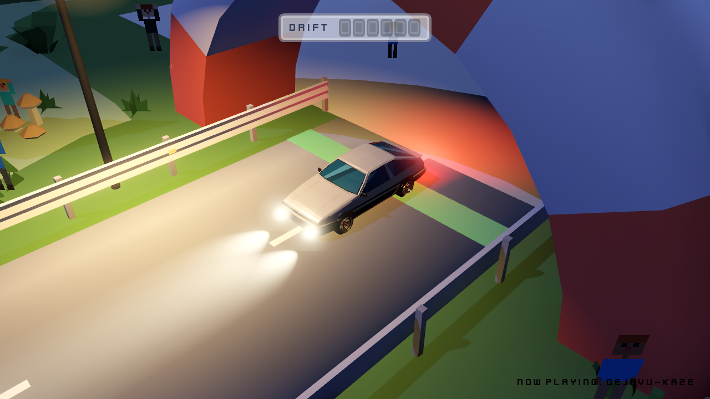
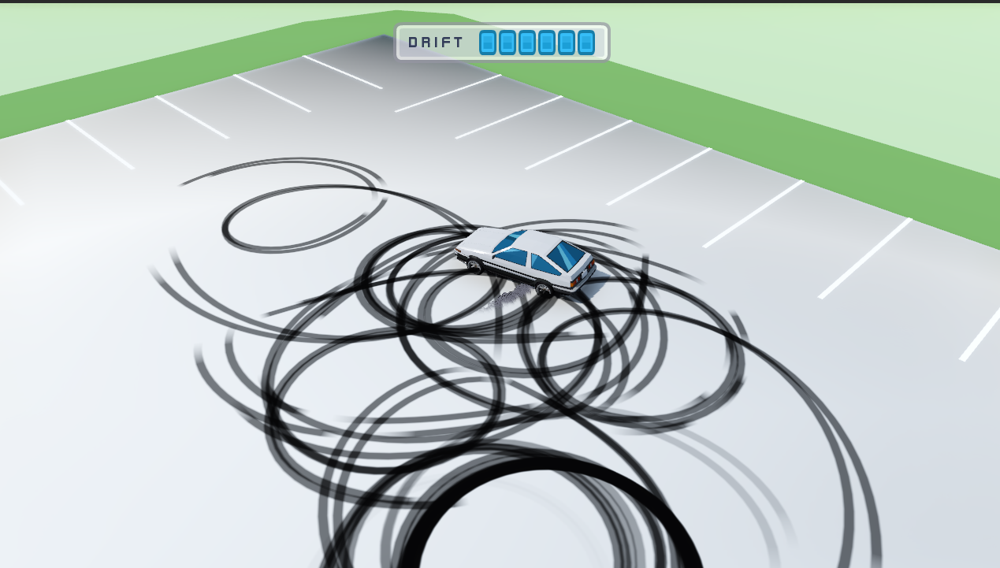

  

<h1 align="center">Deja Vu Racing</h1>

  Arcade drift in Godot, liberamente ispirato a <em>Initial D</em> e alla cultura JDM. 
  Fork del <a href="https://github.com/KenneyNL/Starter-Kit-Racing">Starter Kit Racing</a> di Kenney: non è più solo il template.

  

> Work in progress · **Godot 4.7** (Forward+) · fisica **Jolt**

## Come provarlo

1. Installa [Godot 4.7](https://godotengine.org/download).
2. Clona il repository e apri `project.godot`.
3. Premi F5. La scena di avvio è `scenes/menu.tscn`.

Dal menu: **Single Player**, poi un tracciato. **Option** è ancora un segnaposto.

## Controlli

Tastiera, frecce e gamepad (stick sinistro e grilletti).

| Input | Azione |
| --- | --- |
| <kbd>W</kbd> / <kbd>↑</kbd> / grilletto destro | Acceleratore |
| <kbd>S</kbd> / <kbd>↓</kbd> / grilletto sinistro | Freno e retromarcia |
| <kbd>A</kbd> <kbd>D</kbd> / <kbd>←</kbd> <kbd>→</kbd> / stick sinistro | Sterzo |
| <kbd>R</kbd> | Riavvia la discesa. Nel riepilogo: **Retry** |
| <kbd>Esc</kbd> | Dal riepilogo di gara torna al menu |

La **Drift Bar** in alto si riempie con l'angolo di sbandata, sei segmenti da circa 10° a 42°. Sale subito e scende un pezzo alla volta.

## Tracciati

  

Lo screenshot del menu è precedente all'ultima voce: oggi c'è anche **Mountain Night**.

### Circuit

`scenes/main.tscn`. Il circuito a tile del kit, ancora una `GridMap`, con i furgoni parcheggiati come scenografia. Giro libero, senza traguardo. AE86, fumo, segni delle gomme e *Dejavu Kaze*.

  

### Mountain

`scenes/test_mountain.tscn`. Discesa generata a runtime da un `Path3D`: il primo punto è la partenza, l'ultimo il traguardo. L'auto va a 1,5× rispetto al circuito.

- Terreno, asfalto, piazzali di cemento, archi di partenza e arrivo
- Guardrail a W, pali e catarifrangenti. Il collider resta quello del muro
- Il cofano e la coda collidono coi muri, non solo la sfera di fisica sotto l'auto
- Alberi del kit originale, più il **Kenney Nature Kit**: pini, cespugli, erba, fiori, tronchi e rocce nell'interno dei tornanti. Vicino alla strada hanno un collider
- Spettatori in pixel art ai lati della partenza, che alzano le braccia
- Al traguardo il gioco va in pausa: tempo sul giro e, per ogni livello della Drift Bar, la percentuale di gara passata a quell'angolo. **Retry** ricarica la scena, **Menu** torna indietro

### Mountain Night

`scenes/test_mountain_night.tscn`. La stessa strada, di notte: luna, nebbia, glow, lampioni che si spengono oltre una certa distanza, fari e fanali sull'AE86, catarifrangenti più accesi.

  

## In auto

- Modello **Toyota AE86**. Le quattro ruote rotolano con la velocità; le anteriori sterzano. La scocca si inclina in accelerazione e in curva
- Fumo dalle posteriori quando l'auto derapa, e stridio che sale con l'intensità
- **Segni delle gomme** sull'asfalto, anche in pendenza. Restano circa un minuto e sfumano negli ultimi secondi

  

- Motore con volume e pitch legati a velocità e gas, più un impatto sulle collisioni
- Camera che segue l'auto e arretra quando prendi velocità
- Banner *Now Playing* all'ingresso di una scena, poi sparisce
- In menu gira un edit di *Dejavu*; in gara, *Dejavu Kaze*

## Cosa non c'era nel README vecchio

Il testo precedente descriveva ancora il template: controlli base, tile, e come sostituire il modello Kenney. Da allora il progetto è diventato un gioco, non un kit da cui partire.

| Aggiunto | Dove |
| --- | --- |
| Menu, splash, icona, selezione tracciati | `scenes/menu.tscn` |
| AE86 con roll e sterzo delle ruote | `scenes/vehicle.tscn` |
| Drift Bar a sei segmenti | `scripts/drift_bar.gd` |
| Fumo, stridio, motore, impatto | `scripts/vehicle.gd` |
| Segni delle gomme con fade | `scripts/skid_marks.gd` |
| Mountain da `Path3D`, con quota e tornanti | `scripts/mountain_road.gd` |
| Guardrail, piazzali, archi, collider di carrozzeria | stessa scena, novembre 2026 |
| Nature Kit ricolorato, rocce nei tornanti | `assets/kenney_nature-kit/` |
| Spettatori billboard | `scripts/spectators.gd` |
| Notte: lampioni, fari, fanali, nebbia | `scripts/test_mountain_night.gd` |
| Riepilogo di gara (tempo e drift %) | `scripts/race_summary.gd` |
| Colonna sonora e banner *Now Playing* | `ost/` |

## Personalizzare

### Circuito a tile

In `scenes/main.tscn` seleziona `GridMap` e piazza i tile di `models/Library` (compreso il tofu shop).

### Discesa

In `scenes/test_mountain.tscn` modifica la curva `RoadPath`. All'avvio `scripts/mountain_road.gd` ricostruisce terreno, strada, guardrail e vegetazione. La notte riusa la stessa curva e la stessa logica.

### Modello dell'auto

L'auto in gioco è `models/vehicle-toyota-ae86.glb`, instanziata in `scenes/vehicle.tscn`. Le ruote non hanno i nomi del kit Kenney: stanno sotto `RootNode/Car` come `Wheel1` … `Wheel4` (1 e 3 davanti, 4 e 2 dietro).

I furgoni e `scenes/vehicle-motorcycle.tscn` sono ancora nel progetto, ma non nel menu. Per quei modelli Kenney i figli attesi restano `body`, `wheel-front-left`, `wheel-front-right`, `wheel-back-left`, `wheel-back-right`.

## Licenza

Il codice è [MIT](LICENSE), copyright Kenney / LemoniceIT.

Modelli, interfaccia e audio hanno licenze diverse: l'elenco è in [CREDITS.md](CREDITS.md).

**La musica generata con Suno è solo per uso non commerciale.** Il resto del progetto non la rende liberamente ridistribuibile.
